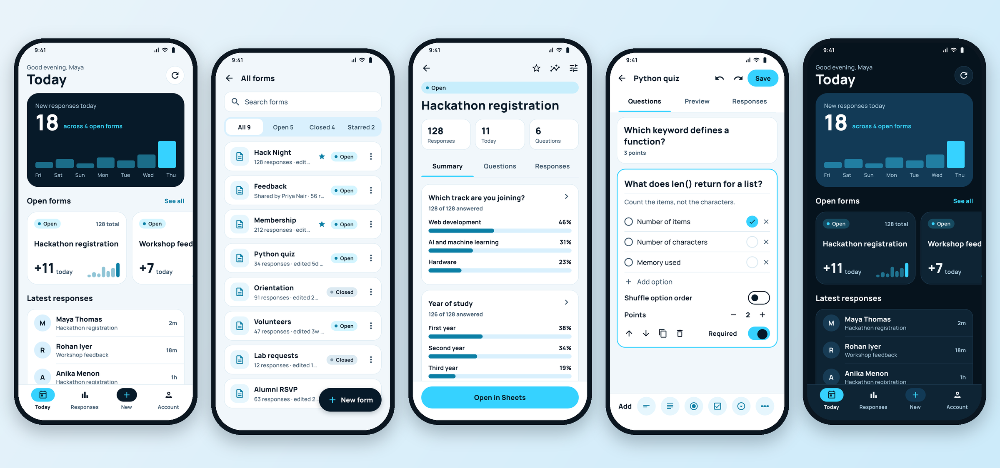
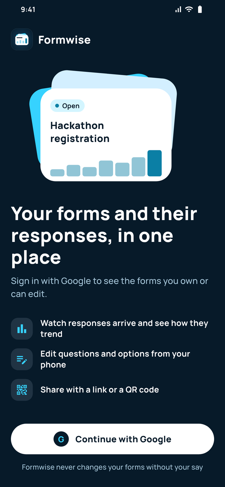
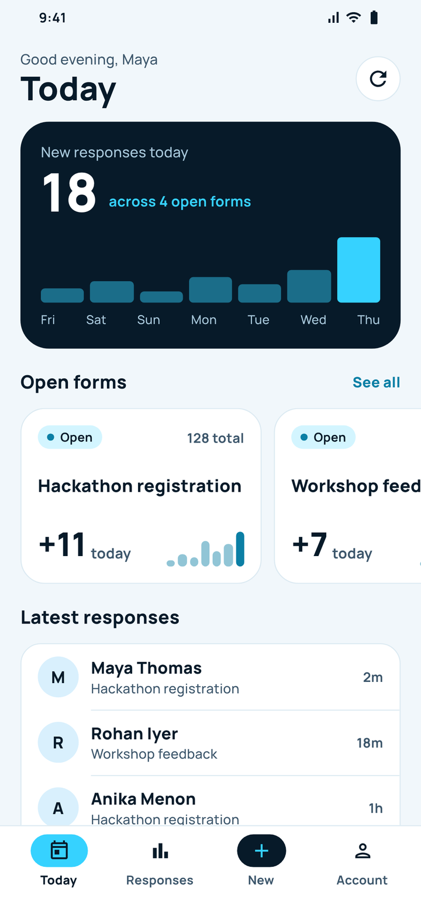
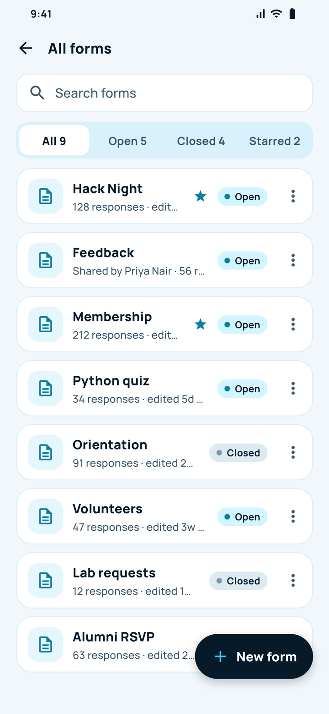
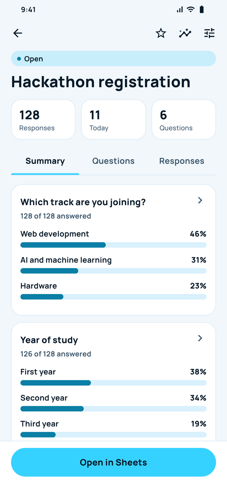
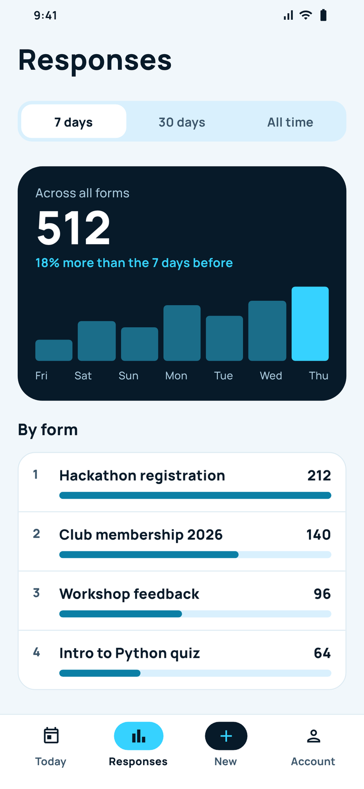
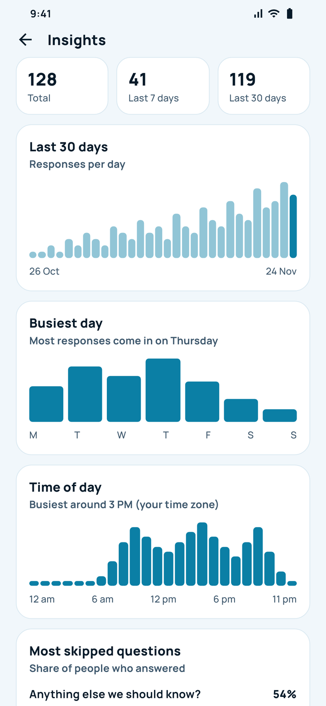
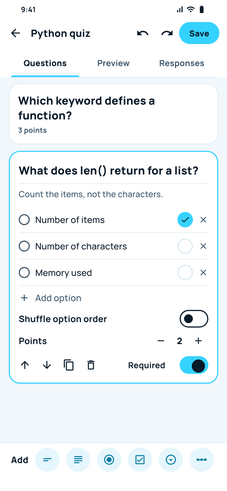
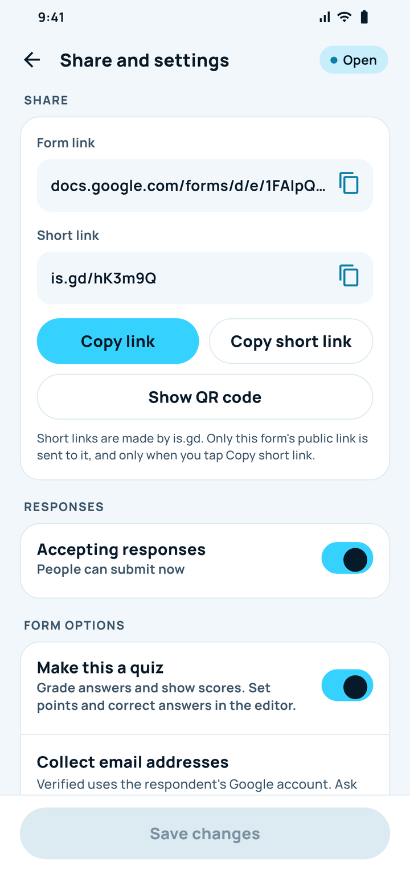
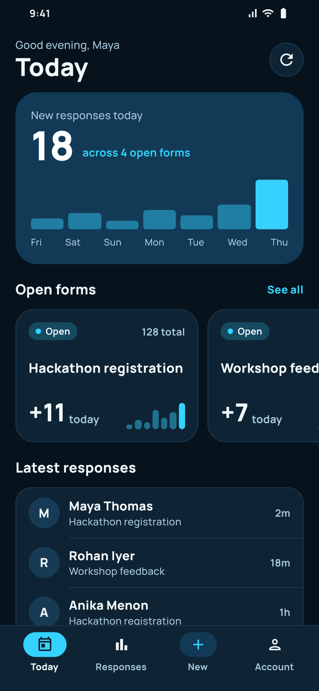

# Formwise

An open-source Android app for managing your Google Forms from your phone: see responses, edit questions, run quizzes, share forms and invite editors. It runs entirely on your device and talks straight to Google's APIs. There is no server and no analytics. The one request that goes elsewhere is the optional **Copy short link** button, which sends a form's public link (and nothing else) to [is.gd](https://is.gd) to make a short version.

> **Not affiliated with Google.** "Google Forms" and "Google Drive" are trademarks of Google LLC. This project is an independent client built on Google's public APIs.

<p align="center">
  
</p>

## Screenshots

<table>
  <tr>
    <td align="center" width="33%">
      <br>
      <sub><b>Sign-in</b></sub>
    </td>
    <td align="center" width="33%">
      <br>
      <sub><b>Today</b></sub>
    </td>
    <td align="center" width="33%">
      <br>
      <sub><b>All forms</b></sub>
    </td>
  </tr>
  <tr>
    <td align="center" width="33%">
      <br>
      <sub><b>Form summary</b></sub>
    </td>
    <td align="center" width="33%">
      <br>
      <sub><b>Responses</b></sub>
    </td>
    <td align="center" width="33%">
      <br>
      <sub><b>Insights</b></sub>
    </td>
  </tr>
  <tr>
    <td align="center" width="33%">
      <br>
      <sub><b>Quiz editor</b></sub>
    </td>
    <td align="center" width="33%">
      <br>
      <sub><b>Share and settings</b></sub>
    </td>
    <td align="center" width="33%">
      <br>
      <sub><b>Dark theme</b></sub>
    </td>
  </tr>
</table>

<sub>These are preview renders drawn with the app's own colours, fonts and layout, using made-up sample data. Replace them with screenshots from your device if you like (see below).</sub>

## Features

**Dashboard**
- **Today:** open forms, today's response count, a 7-day chart and the latest responses.
- **Responses:** totals for 7 days, 30 days or all time, a bar chart and a per-form ranking.
- **All forms:** search, filter by All, Open, Closed or Starred, see who shared a form with you, and use the ⋮ menu for quick actions (open in Sheets, copy link, duplicate, star, stop or resume responses, move to trash).

**Inside a form**
- **Summary, Questions and Responses tabs,** with answer rates, search across responses, and **Load more** beyond the first 500 responses.
- **Question detail:** the full breakdown for a choice or scale question, or every answer to a text question with search.
- **Response viewer:** each response with previous and next, and quiz scores with correct and incorrect marks.
- **Insights:** a 30-day trend, busiest day, time of day, most-skipped questions and quiz score spread.
- **Export:** save or share the loaded responses as a CSV. Cells that start with `=`, `+`, `-` or `@` are prefixed with an apostrophe so a spreadsheet cannot run them as formulas.

**Editing**
- **Question types:** short answer, paragraph, multiple choice, checkboxes, dropdown, linear scale, date and time.
- **Per question:** description, required, shuffled options, and for quizzes the points and correct answers.
- **Editor tools:** drag to reorder, undo and redo, live preview. Changes are saved in one batch, and edits made elsewhere in the meantime are detected instead of overwritten.

**Sharing and settings**
- Copy the link, copy a short link, show a QR code.
- Stop or resume accepting responses, turn quiz mode on or off, choose how email addresses are collected.
- Invite or remove editors, rename the form in Drive, move it to the trash.

**Everything else**
- **New form:** blank, or from an event sign-up, feedback survey or quiz template.
- **Trash:** restore forms or delete them for good.
- **Light and dark themes,** with a System, Light or Dark choice in Account.
- **First-run intro,** a Help screen and a Privacy and permissions screen.
- **Adaptive app icon** with a themed (monochrome) version for Android 13 and up.

### Known limits

These come from what Google's APIs allow, not from the app:

- **Not possible through the APIs:** file upload questions, deleting a single response, themes and header images, and push notifications for new responses (Forms watches publish to Cloud Pub/Sub, which needs a backend).
- **Only in Google Forms:** close dates, email notifications and "one response per person".
- **Kept but not editable:** sections, grids, images, videos and file-upload questions are preserved when you save, but they are hidden in the editor. A note shows how many.
- **Loading:** the list follows Drive's paging up to 500 forms, and each form loads up to 500 responses at a time. Export and Insights use the responses loaded so far.
- **Rename** changes the file name in Drive. The title respondents see is edited in the editor.
- **Short links** come from is.gd, not `forms.gle`. Google creates `forms.gle` links only inside Forms itself.
- **Quizzes:** points and correct answers are supported. Answer feedback text is not.
- **Email collection** uses a newer Forms API setting. If Google rejects it for a form, the app shows an error and changes nothing.

## Build it yourself

Google only allows sign-in for apps registered in a Google Cloud project, and a registration is tied to one app signature. So **you create your own free registration (about 10 minutes) and build the app with it.** No keys or secrets go into the code.

### What you need

- [Android Studio](https://developer.android.com/studio) (current stable) with an Android 8.0+ (API 26) phone or emulator
- A Google account to test with
- Git

### Step 1: Get the code

```bash
git clone https://github.com/<your-username>/<repo-name>.git
cd <repo-name>
```

Open the folder in Android Studio and let Gradle sync. It won't sign in yet: that needs the next steps.

### Step 2: Find your app's package name

Open `app/build.gradle.kts` and note the `applicationId` (the default is `app.formsmanager`). You enter it in Google Cloud exactly as written. If you change it for your own fork, change `namespace` and the Kotlin package names to match, and use your new value everywhere below.

### Step 3: Get your debug SHA-1

Google identifies your build by its signing key. Run this from the project folder:

```bash
# macOS / Linux
./gradlew signingReport

# Windows (Command Prompt, PowerShell or the Android Studio terminal)
gradlew signingReport
```

Find the section titled **Variant: debug** and copy the line that starts with `SHA1:`. It looks like `AB:CD:12:...` (20 pairs).

You can also read it with `keytool`. For the default debug key (password `android`):

```bash
keytool -list -v -keystore ~/.android/debug.keystore -alias androiddebugkey
```

> The SHA-1 belongs to one signing key. A different computer's debug key, or a release key, has a different SHA-1 and needs its own client (Step 6).

### Step 4: Create a Google Cloud project and turn on the APIs

1. Open the [Google Cloud Console](https://console.cloud.google.com/), click the project dropdown, then **New Project**. Name it anything and create it. Make sure it is the selected project.
2. Enable the [Google Forms API](https://console.cloud.google.com/apis/library/forms.googleapis.com) (click **Enable**).
3. Enable the [Google Drive API](https://console.cloud.google.com/apis/library/drive.googleapis.com) (click **Enable**).

### Step 5: Set up the consent screen (Google Auth Platform)

Open [Google Auth Platform](https://console.cloud.google.com/auth/overview). It has pages for **Branding**, **Audience**, **Clients** and **Data Access**.

1. Click **Get started**.
2. **App information:** enter an app name and your email as the support email.
3. **Audience:** choose **External**.
4. **Contact information:** enter your email, agree to the policy and click **Create**.
5. Open **Data Access → Add or remove scopes**. In the **Manually add scopes** box, paste these three (one per line), click **Add to table**, then **Update** and **Save**:
   ```
   https://www.googleapis.com/auth/drive
   https://www.googleapis.com/auth/forms.body
   https://www.googleapis.com/auth/forms.responses.readonly
   ```
6. Open **Audience**. Leave the status on **Testing**. Under **Test users**, click **Add users** and add the Gmail address you will sign in with.

> **Keep it in Testing mode.** In Testing mode only the listed test users (up to 100) can sign in, and Google shows a warning screen. Their approval **expires after 7 days**, so you will be asked to approve again about once a week. That is fine for personal or club use.
>
> Publishing the app to everyone is a different path. Apps that use sensitive or restricted scopes must pass Google's verification first, and the full Drive scope (`.../auth/drive`) is a restricted scope, so expect a heavier review.

### Step 6: Create the Android client

1. Open **Google Auth Platform → Clients** and click **Create client**.
2. Choose **Android** as the application type.
3. Enter a name, your **package name** (Step 2) and your **SHA-1** (Step 3).
4. Skip the optional "Verify app ownership" and click **Create**.

An Android client has no secret to download, and there is nothing to paste into the code. Google matches your app by its package name and SHA-1. Changes can take from a few minutes to a few hours to start working.

### Step 7: Run the app

1. Connect a phone with **USB debugging** turned on, or start an emulator.
2. Press **Run** in Android Studio.
3. Tap **Continue with Google**, pick your test-user account and approve the permissions.
4. Google shows "Google hasn't verified this app". Tap **Advanced → Go to (your app name) (unsafe)**. This is expected for your own app in Testing mode.

Your forms load, and you're in.

## Release builds

A release APK is signed with a key you own. Create one once and keep it safe. If you lose it you cannot update the app, and its SHA-1 changes.

**1. Create the keystore**

```bash
keytool -genkeypair -v -keystore formwise-release.jks -alias formwise \
  -keyalg RSA -keysize 2048 -validity 10000
```

**2. Add `keystore.properties` in the project root** and add both it and the `.jks` file to `.gitignore`. Never commit them.

```properties
storeFile=../formwise-release.jks
storePassword=YOUR_STORE_PASSWORD
keyAlias=formwise
keyPassword=YOUR_KEY_PASSWORD
```

**3. Use it in `app/build.gradle.kts`.** Add this at the top of the file:

```kotlin
import java.util.Properties

val keystoreProps = Properties().apply {
    val f = rootProject.file("keystore.properties")
    if (f.exists()) f.inputStream().use { load(it) }
}
```

Inside `android { }`, above `buildTypes`:

```kotlin
signingConfigs {
    create("release") {
        storeFile = file(keystoreProps.getProperty("storeFile"))
        storePassword = keystoreProps.getProperty("storePassword")
        keyAlias = keystoreProps.getProperty("keyAlias")
        keyPassword = keystoreProps.getProperty("keyPassword")
    }
}
```

And in the `release` build type use `signingConfig = signingConfigs.getByName("release")`.

**4. Register the release key with Google.** Get its fingerprint:

```bash
keytool -list -v -keystore formwise-release.jks -alias formwise
```

Then repeat **Step 6** in the same Cloud project with the same package name and the **release SHA-1**. A project can hold several Android clients, so keep the debug one too. If you later publish through Google Play with Play App Signing, add the app signing key's SHA-1 (shown in Play Console under App integrity) as another client.

**5. Build**

```bash
./gradlew clean assembleRelease      # Windows: gradlew clean assembleRelease
```

The APK is at `app/build/outputs/apk/release/app-release.apk`. For a Play Store bundle use `bundleRelease` instead.

### Sharing the APK with others

Everyone can install the same release APK. Add each person's Google address under **Audience → Test users** (up to 100). They see the same "hasn't verified this app" screen and approve once a week.

Android may show a **Play Protect** "Scan app" prompt for an APK installed outside the Play Store. That is normal. Tap **Scan app**, or install over USB with `adb install -r app-release.apk`.

## Troubleshooting

| What you see | Likely cause and fix |
| --- | --- |
| "Developer error" or error code 10 | The package name or SHA-1 in the client doesn't match your build. Re-check both, and wait a few minutes after creating the client. Remember a release build has a different SHA-1 from a debug build. |
| "Access blocked" or error 403: access_denied | Your account isn't in **Test users**. Add it under Audience. |
| 403 that mentions an API being disabled | Enable the Forms API and the Drive API in the same Cloud project. |
| 403 "insufficient scopes" when inviting | The `drive` scope isn't granted. Add it under Data Access, then sign out and tap **Continue with Google** again to approve it. |
| Asked to approve access again after about a week | Normal for apps in Testing mode. Approve again. |
| Creating the client says the package and fingerprint are already in use | Another project already has a client for that exact pair. Change your `applicationId` (and `namespace`) to something unique. |
| Short link fails | The is.gd service didn't answer. Try again later, or use the full link. |
| "Set up screen lock to use passkeys" on an emulator | Your Google account uses a passkey. Set a screen lock (PIN) on the emulator, or choose another sign-in method. |
| Build error: `Unresolved reference: R` | Your `namespace` in `app/build.gradle.kts` differs from the `app.formsmanager` package. Make the package declarations and imports match. |
| Build error mentioning a file in `res/font` | Only `.ttf` or `.otf` fonts with lowercase names belong there. Keep licence text outside `res`. |
| `signingReport` task not found | Run it from the project root with the wrapper (`gradlew` or `./gradlew`), not from the Gradle panel. |

## Project layout

```
app/src/main/java/app/formsmanager/
├── MainActivity.kt          # navigation host, export and theme wiring
├── SessionViewModel.kt      # sign-in state, routes, form and Drive actions
├── auth/GoogleAuth.kt       # Google authorization (scopes, token)
├── api/                     # Forms and Drive REST calls, parsing, save diff, templates,
│                            #   response parsing, link shortener
├── editor/                  # form draft model, commands, undo stack, editor screens
└── ui/                      # screens, shared components, theme, CSV export
app/src/main/res/
├── font/                    # Manrope Medium, Bold and ExtraBold (static files)
├── drawable/                # adaptive icon layers (background, foreground, monochrome)
├── mipmap-anydpi/           # adaptive icon definitions
└── values-night/            # dark window background
licenses/                    # font licence text
```

**How saving works:** the editor keeps your edits as a draft. When you press **Save**, the draft is compared with the form as it was loaded and turned into one `batchUpdate` request guarded by the form's revision ID, so edits made elsewhere in the meantime are caught instead of overwritten. For questions that already exist, only the fields that changed are sent, so Google keeps each question's ID and the link to its existing responses.

## Design

- **Themes:** colours are named by role (`Canvas`, `Surface`, `Ink`, `InkMuted`, `Hero`, `Track`) and switch between light and dark. Brand colours (`Navy`, `Cyan`, `OnCyan`) never change. Tokens are in `editor/ui/FormsColors.kt`.
- **Components:** shared pieces live in `ui/Components.kt`: `TopBar`, `LargeTitle`, `SegmentedControl`, `UnderlineTabs`, `BottomNav`, `BottomActionBar`, `WhiteCard`, `StatTile`, `IconTile`, `FormwiseMark`.
- **Font:** Manrope as three static files (500, 700, 800). A single variable font file was avoided because some devices ignore its weight setting and draw everything in the thinnest weight.
- **Icon:** the launcher icon and the in-app logo draw from the same artwork (`ic_launcher_foreground.xml`).

## Privacy

- The app calls Google's APIs (Forms, Drive and Google sign-in). The one exception is the optional short link, which sends the form's public link to is.gd when you tap **Copy short link**.
- It has no backend, no analytics and no ads.
- Access tokens are requested from Google when needed and are not stored by the app. Form data is held in memory while the app is open.
- It reads and changes forms only when you open them or press a save, invite, trash or settings button.
- The Drive permission is requested as Google's full Drive scope, because listing existing forms and managing editors needs it. The app only uses it for those form actions.
- Signing out returns you to the sign-in screen. To remove access completely, revoke it at [myaccount.google.com/permissions](https://myaccount.google.com/permissions).

### Taking your own screenshots

With a phone connected over USB and the app showing sample data (not real responses or names):

```bash
adb exec-out screencap -p > docs/screenshots/today.png
```

Keep real respondents' names and emails out of anything you publish.

## Contributing

Issues and pull requests are welcome. Please:

1. Open an issue first for larger changes.
2. Keep changes focused, and keep the code free of unused imports and debug output.
3. Check that `gradlew assembleDebug` succeeds before submitting.

## Credits

- [Manrope](https://fonts.google.com/specimen/Manrope) font by The Manrope Project Authors, SIL Open Font License 1.1 (license text in [`licenses/Manrope-OFL.txt`](licenses/Manrope-OFL.txt)). The three static weights were cut from the variable font.
- [ZXing](https://github.com/zxing/zxing) for QR codes, Apache License 2.0
- [Reorderable](https://github.com/Calvin-LL/Reorderable) for drag-and-drop lists, Apache License 2.0
- Jetpack Compose and Material 3 by Google

## License

Add your chosen license here, for example: *Released under the Apache License 2.0. See [LICENSE](LICENSE).*
